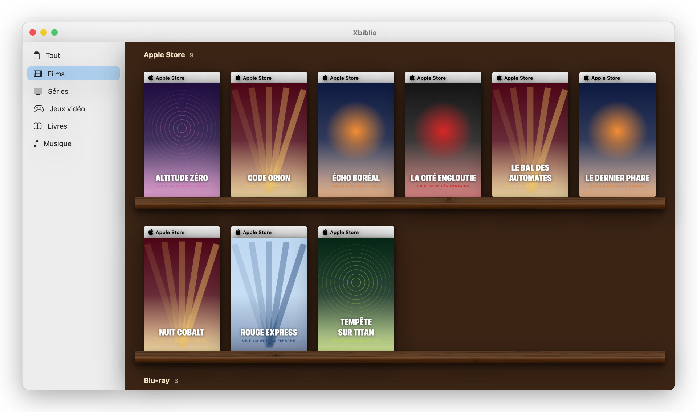
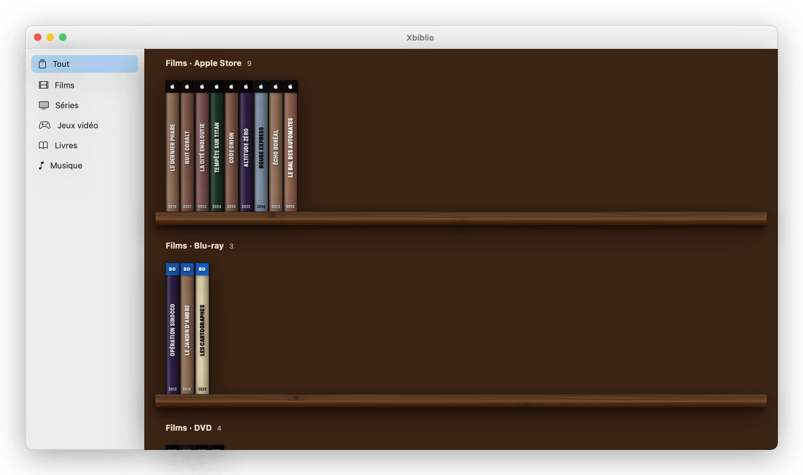
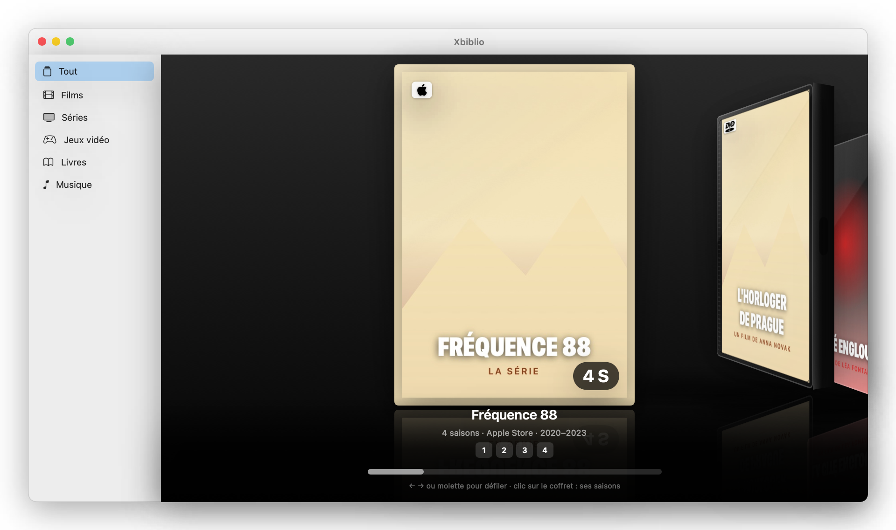

# Xbiblio

> Mac à puce Apple\
> macOS 14 ou plus récent

Vidéothèque et ludothèque personnelles pour Mac : films, séries, jeux vidéo, LEGO, livres et musique, rangés sur de vraies étagères.
Xbiblio reçoit les nouveautés en premier ; [Shelfie](https://github.com/Lkoubiac/Shelfie) en est la version universelle (Mac Intel et macOS 13 compris).

## Ce que fait Xbiblio

- **Étagères** en bois ou en métal, jaquettes de face ou **tranches**. En haut de chaque jaquette, un **bandeau du support** (DVD, Blu-ray, Apple Store, numérique avec VO / VF), comme sur les vraies boîtes ; un titre possédé sur plusieurs supports montre le principal en bandeau et les autres en pastilles. Au choix dans les réglages : bandeau, petit logo ou rien.
- **Jeux vidéo** dans des boîtiers aux couleurs de leur console (PlayStation, Xbox…), avec le bandeau de la console.
- **LEGO** : de vraies boîtes en relief, plus grandes selon le nombre de pièces du set ; numéro, thème, pièces et figurines retrouvés tout seuls (Rebrickable).
- **Coverflow** : les jaquettes défilent dans de vrais boîtiers en volume (DVD, Blu-ray, Apple Store, numérique, jeux) ; chaque série est un coffret qui s'ouvre sur ses saisons, avec la tranche de chaque saison côté ouverture.
- **Glisser une image** sur une jaquette (depuis le Finder, Aperçu ou une page web) pour la remplacer, avec un cadre pour l'ajuster ; sur un coffret, elle devient l'affiche de la série.
- **Trois tailles de jaquettes** d'un coup de curseur (Petite, Moyenne, Grande), et un réglage fin dans les Réglages.
- **Fiche dans une colonne** à droite de l'étagère, modifiable sur place (option).
- **Fiches remplies toutes seules** : jaquette, année, résumé, réalisateur et acteurs, saisons et épisodes (TMDB, RAWG, Open Library, MusicBrainz, Wikipédia, Rebrickable).
- **Options par rubrique** : résumés, acteurs, sagas, saisons manquantes, épisodes, VO / VF…
- **Import** depuis un fichier Excel ou CSV (un onglet par rubrique).
- **Liste d'envies** et **prêts** (à qui, depuis quand).
- **Sauvegardes automatiques**, et une bibliothèque qui peut être partagée entre deux Mac par iCloud Drive (avec Shelfie aussi).
- **Mises à jour automatiques**.

## Installer

1. Téléchargez le fichier `Xbiblio-….zip` de la [dernière version](https://github.com/Lkoubiac/Xbiblio/releases/latest).
2. Ouvrez-le, puis glissez **Xbiblio** dans le dossier **Applications**.
3. Au premier lancement, macOS peut refuser d'ouvrir une app téléchargée : faites un clic droit sur Xbiblio › **Ouvrir**, puis confirmez.

## Mises à jour

Xbiblio vérifie toute seule les nouvelles versions. Pour le faire tout de suite : menu **Xbiblio › Rechercher les mises à jour…**

---

*Les images montrent une bibliothèque d'exemple inventée (titres et jaquettes imaginaires).*
